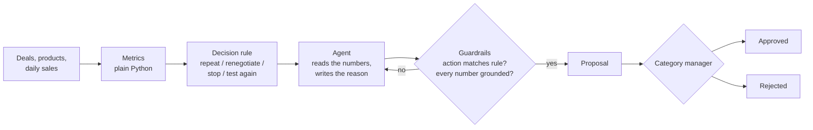

# Deal Agent: which promotions should a marketplace run again?

[](https://github.com/ismraviranjan-netizen/deal-agent/actions/workflows/ci.yml)


An AI agent that reviews e-commerce promotional deals (lightning deals, coupons, festival events)
and recommends one of four actions for each: **repeat**, **renegotiate**, **stop** or **test again**.
A category manager approves or rejects every recommendation. Nothing is applied automatically.

The idea comes from a real problem in marketplace category management: a deal can look like a
success because units and GMS spiked, while losing money once you count who funded the discount
and how much demand was simply pulled forward from next week.

**All data in this repository is synthetic.** It is shaped like marketplace deal data, but no
figure, product or seller comes from a real company.

## What it measures

| Metric | Meaning |
|---|---|
| Units spike | Daily units during the deal, divided by the 14-day baseline before it |
| GMS spike | Deal GMS divided by what the baseline would have sold at list price |
| Investment % of GMS | What the platform paid (its share of the discount, plus fees) as a share of deal GMS |
| Pull-forward | Units lost in the 7 days after the deal, because shoppers bought early |
| Incremental profit | Extra margin the deal earned, after the baseline, pull-forward and investment |
| ROI | Incremental profit per rupee the platform invested |
| Break-even funding share | The largest share of the discount the platform can fund without losing money |

## Sample output

`python -m dealagent score` on the bundled dataset (first 12 of 48 deals):

| Deal | SKU | Units spike | GMS spike | Investment % of GMS | Incremental profit | ROI | Action |
|---|---|---|---|---|---|---|---|
| D-0001 | SKU-0001 | 3.08x | 2.77x | 4.4% | 39,868 | 5.16 | REPEAT |
| D-0002 | SKU-0001 | 2.12x | 1.59x | 31.7% | -5,647 | -0.17 | RENEGOTIATE |
| D-0003 | SKU-0002 | 1.02x | 0.97x | 11.8% | -9,538 | -1.21 | STOP |
| D-0004 | SKU-0002 | 3.03x | 2.73x | 4.7% | 52,299 | 3.26 | REPEAT |
| D-0005 | SKU-0003 | 1.87x | 1.38x | 33.3% | -40,353 | -0.47 | RENEGOTIATE |
| D-0006 | SKU-0003 | 1.0x | 0.94x | 7.9% | -6,527 | -1.02 | STOP |
| D-0007 | SKU-0004 | 3.39x | 3.05x | 5.6% | 24,029 | 2.7 | TEST_AGAIN |
| D-0008 | SKU-0004 | 2.75x | 2.37x | 6.6% | 20,919 | 1.95 | REPEAT |
| D-0009 | SKU-0005 | 3.11x | 2.8x | 4.6% | 82,058 | 4.16 | REPEAT |
| D-0010 | SKU-0005 | 2.49x | 1.87x | 30.5% | -46,090 | -0.26 | RENEGOTIATE |
| D-0011 | SKU-0006 | 0.96x | 0.92x | 19.0% | -9,708 | -1.36 | STOP |
| D-0012 | SKU-0006 | 2.79x | 2.45x | 7.7% | 13,767 | 1.7 | REPEAT |

A recommendation the agent recorded for approval:

> **D-0002 · RENEGOTIATE** · Units ran at 2.12x baseline and GMS at 1.59x over 3 days, against a
> category median of 2.18x. The platform invested 33275 (31.7% of deal GMS) for an incremental
> profit of -5647, an ROI of -0.17. The platform funds 92.0% of the discount; ask the brand to
> bring that down to 61% before repeating.

## Live run with Claude

The agent was run against Claude Sonnet 5.5 on four deals, one for each outcome. Every review
finished in four steps (metrics, benchmark, proposal, summary), reached the action the decision rule
gives, and had no rationale rejected by the grounding check. These are Claude's explanations as recorded:

| Deal | Action | Claude's rationale |
|---|---|---|
| D-0001 | REPEAT | D-0001 lifted units 3.08x versus baseline, above the Home & Kitchen median of 2.18x, with 320 net incremental units after pull-forward. Its ROI was 5.16 against a category median of -0.43, and investment was 4.4% of GMS versus a median of 21.25%, so the deal earned more than it cost. |
| D-0002 | RENEGOTIATE | Units rose with a 2.12 spike (category median 2.18), but the platform funded 92.0% of the discount and the deal's ROI was -0.17, with an incremental profit of -5647. Investment was 31.7% of GMS versus a category median of 21.25%, and the breakeven platform share is 75.9%, so we should renegotiate funding toward the 61% target share. |
| D-0003 | STOP | The deal barely moved volume: units spike was 1.02 versus a Personal Care median of 2.44, and net incremental units were -11 after 13 pull-forward units. Investment was 11.8% of GMS (category median 6.95%) and ROI was -1.21 against a median of 1.49, with incremental profit of -9538. |
| D-0007 | TEST_AGAIN | The rule says there are too few clean days before the deal (baseline_days 3) to trust the baseline, so the results should be confirmed with another test. On the face of it the deal looks strong: units spike 3.39 vs the category median of 2.69, and ROI 2.7 vs the median of 1.79, with investment at 5.6% of GMS vs a median of 6.8%. These figures rest on the short baseline, so they are not reliable enough to repeat or stop the deal. |

Cost was roughly 1 to 2 US cents per review (read from the API credit balance, November 2026).
Four deals is a smoke test, not an evaluation: the eval gate below still runs on the scripted brain.

## How it works



**Maths decides, the model explains.** All arithmetic and the decision rule are ordinary Python
(`dealagent/metrics.py`, `dealagent/rules.py`). The model's job is to read the result, compare
it with the category benchmark, and write a short reason a manager can check.

## Guardrails

- **The model cannot override the rule.** `propose_action` rejects any action that differs from the decision rule's.
- **No invented numbers.** Every number in the rationale must match a value in the tool results, or the proposal is rejected and the model has to rewrite it (`dealagent/grounding.py`).
- **Look before you propose.** A proposal for a deal the agent has not pulled metrics for is refused.
- **One open proposal per deal.** Reviewing a deal again while its proposal is still pending records nothing new.
- **Human approval.** Proposals stay pending until a named person approves or rejects them, and a decision cannot be changed afterwards.
- **Hard stops.** A step cap, an output-token budget and a kill switch (`DEAL_AGENT_KILL=1`).

## Run it

No API key and no dependencies are needed for the default mode, which uses a scripted stand-in
for the model so that tests and evals are free and repeatable.

```bash
git clone https://github.com/ismraviranjan-netizen/deal-agent && cd deal-agent
python -m dealagent score                      # score every deal
python -m dealagent review D-0002              # the agent reviews one deal
python -m dealagent review all                 # or all 48
python -m dealagent proposals                  # see what is waiting
python -m dealagent approve PRP-0001 --by "Your Name"
```

To use Claude instead of the scripted brain:

```bash
pip install anthropic
export ANTHROPIC_API_KEY=...                   # your own key
python -m dealagent review D-0002 --live       # set DEAL_AGENT_MODEL to choose the model
```

## Tests and evals

```bash
pip install pytest
python -m pytest -q                            # 29 tests, including hand-worked economics
python evals/run_evals.py --threshold 0.9      # the eval gate
```

The eval gate is the interesting part. Every synthetic deal is generated from a known archetype:
a winner, a deal that is fixable with better funding, a dud, or one with too little baseline data.
The eval runs the whole pipeline on 240 deals across five random seeds and checks that the agent
reaches the planted answer, records exactly one proposal, and quotes only grounded numbers.
The gate needs 90% action accuracy and 100% grounding, and CI runs it on every push.

The archetype label is stored in `data/deals.csv` for the evals only. The agent's tools never expose it.

## Layout

```
dealagent/data.py        synthetic data generator with planted archetypes
dealagent/metrics.py     baseline, spikes, pull-forward, investment, profit, ROI, break-even
dealagent/rules.py       the decision rule
dealagent/tools.py       the three tools the agent may call
dealagent/grounding.py   the "no invented numbers" check
dealagent/agent.py       the agent loop, a scripted brain and a Claude brain
dealagent/approval.py    pending / approved / rejected proposals
dealagent/cli.py         the command line
evals/run_evals.py       the eval gate
tests/                   unit tests
data/                    the bundled synthetic dataset (seed 7)
```

## Limits

- The baseline is a simple 14-day average. It ignores seasonality, stock-outs and competitor activity.
- Cannibalisation of sibling products and halo effects are not modelled.
- The synthetic data is cleaner than real sales data, so the eval score says the pipeline is consistent, not that it would be this accurate in production.

## Author

Built by [Ravi Ranjan](https://github.com/ismraviranjan-netizen). MIT licensed.
